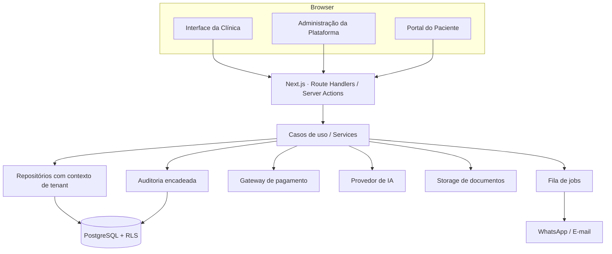

# 01 · Arquitetura da aplicação

## 1. Princípios

1. **Multi-tenant seguro por padrão.** Um único banco, schema compartilhado e `clinic_id` obrigatório nas entidades da clínica. A RLS é a segunda barreira; a primeira é o contexto de sessão no backend.
2. **Duas interfaces, um núcleo.** A administração da plataforma e o ambiente da clínica compartilham autenticação, catálogo e auditoria, mas têm rotas, layouts e permissões distintos.
3. **Operações sensíveis no servidor.** Pagamentos, IA, WhatsApp, assinatura de documentos, convites e exportações nunca dependem do frontend.
4. **Privilégio mínimo.** O superadministrador da plataforma **não** acessa dados clínicos por padrão. Suporte excepcional exige *break-glass* com justificativa, consentimento e auditoria.
5. **Rastreabilidade.** Toda alteração em dado sensível gera evento de auditoria encadeado por hash.

## 2. Stack recomendada

| Camada | Tecnologia | Motivo |
|---|---|---|
| Frontend/Backend | Next.js 15 (App Router), React 19, TypeScript | SSR, Server Actions, route handlers e deploy simples |
| Estilo | Tailwind CSS 4 + componentes próprios | Fidelidade visual às telas de referência |
| Banco | PostgreSQL 16 (Supabase/Neon/RDS) | RLS, constraints, JSONB, extensões |
| ORM/Query | Drizzle ORM + `postgres.js` | SQL explícito, transações e tipagem |
| Validação | Zod | Contratos de entrada e saída |
| Autenticação | Sessão própria (Argon2id + JWT httpOnly) | Portabilidade; adaptador para Supabase/Auth0 |
| Jobs | pg-boss / cron | Lembretes, inadimplência, exames pendentes |
| Arquivos | S3 compatível (R2/Supabase Storage) | URLs assinadas e retenção |
| Pagamentos | Stripe + Asaas | Cartão internacional e Pix/boleto |
| WhatsApp | Meta Cloud API | Templates, entrega e leitura; fallback manual |
| IA | Provedor agnóstico via backend | Guardrails, minimização de PII e auditoria |
| Observabilidade | Sentry + logs estruturados + OpenTelemetry | Erros, latência e trilha |

> O banco de validação local usa **PGlite** (PostgreSQL em WASM) apenas para checar migrations e RLS. Produção usa PostgreSQL 16 real com `pg_trgm`, `btree_gist` e `pgcrypto`.

## 3. Visão de camadas



## 4. Multi-tenancy

### 4.1 Modelo

- `clinics` é a raiz do tenant.
- `clinic_units`, `professionals`, `patients`, `appointments`, `medical_records`, `financial_transactions`, etc. possuem `clinic_id NOT NULL`.
- FKs compostas `(id, clinic_id)` impedem que um registro da clínica A referencie paciente/profissional da clínica B.
- `users` é identidade global; `clinic_memberships` liga usuário ↔ clínica ↔ papel.

### 4.2 Resolução do tenant

1. A sessão guarda o `user_id` e a clínica ativa.
2. O backend valida a membership (`status = 'ativo'`) antes de abrir a transação.
3. A transação executa:
   ```sql
   select set_config('app.user_id', '<uuid>', true);
   select set_config('app.clinic_id', '<uuid>', true);
   ```
4. Toda query passa por repositórios que exigem `clinic_id`; a RLS reforça no banco.
5. `clinic_id` enviado pelo cliente é **ignorado**. O valor vem exclusivamente da sessão.
6. Acesso cruzado responde **404**, não 403, para evitar enumeração.

### 4.3 Plataforma x clínica

| Área | Rota | Quem acessa | Dados clínicos |
|---|---|---|---|
| Plataforma | `/admin/*` | `platform_admin` | Não, por padrão |
| Clínica | `/app/*` | membros da clínica | Conforme papel |
| Portal | `/portal/*` | paciente vinculado | Somente os próprios registros |

O superadministrador gerencia planos, módulos, assinaturas e pagamentos. Métricas da plataforma são agregadas; não expõem prontuários.

## 5. Autenticação e sessão

- Senha com **Argon2id**; nunca armazenar senha em texto puro.
- Sessão em cookie `httpOnly`, `Secure`, `SameSite=Lax`, com rotação de refresh token.
- CSRF em mutações; rate limit por IP/e-mail.
- Convite por e-mail com token de uso único (hash no banco, expiração).
- MFA obrigatório para `platform_admin` e opcional para `clinic_admin`.
- Bloqueio progressivo após tentativas inválidas.
- Logout invalida a sessão no servidor.

## 6. Autorização em três camadas

1. **Rota/layout:** exige autenticação e área correta.
2. **Permissão:** `app_has_permission(clinic_id, 'modulo:acao')`.
3. **Registro:** RLS por `clinic_id`, papel e vínculo com o paciente/profissional.

A interface esconde o que o usuário não pode fazer, mas a decisão nunca depende disso.

## 7. Backend: funções sensíveis

| Função | Responsabilidade |
|---|---|
| `POST /api/auth/login` | Validar credenciais, criar sessão, auditar |
| `POST /api/auth/invite/accept` | Aceitar convite e criar membership |
| `POST /api/clinic/patients` | Validar CPF, consentimento LGPD, criar paciente |
| `POST /api/clinic/appointments` | Checar conflito de agenda e unidade |
| `POST /api/clinic/records/:id/sign` | Gerar hash, assinar, versionar e auditar |
| `POST /api/clinic/prescriptions/:id/sign` | Código de verificação e PDF |
| `POST /api/clinic/exams/:id/release` | Liberar resultado e notificar |
| `POST /api/clinic/finance/transactions` | Lançamento e baixa com auditoria |
| `POST /api/clinic/ai/assist` | Guardrails, minimização de PII e registro |
| `POST /api/clinic/whatsapp/send` | Template, status e vínculo com consulta |
| `POST /api/platform/clinics` | Criar clínica + unidade matriz + admin + assinatura |
| `POST /api/platform/payments` | Registrar pagamento e renovar assinatura |
| `POST /api/webhooks/stripe` | Idempotência via `gateway_events` |
| `POST /api/webhooks/asaas` | Pix/boleto e conciliação |
| `POST /api/webhooks/whatsapp` | Status de entrega/leitura |
| `GET /api/public/verify/:code` | Verificar autenticidade de documento |

## 8. Estrutura de pastas prevista

```text
src/
├── app/
│   ├── (auth)/login, convite, recuperar-senha
│   ├── (platform)/admin/...
│   ├── (clinic)/app/...
│   ├── (portal)/portal/...
│   └── api/...
├── components/
│   ├── ui/                 # botões, inputs, modais, tabelas
│   ├── clinic/             # sidebar, header, cards
│   └── platform/           # layout administrativo
├── features/
│   ├── patients/           # schema, service, queries, actions, components
│   ├── appointments/
│   ├── records/
│   ├── prescriptions/
│   ├── exams/
│   ├── finance/
│   ├── insurance/
│   ├── inventory/
│   ├── subscriptions/
│   └── platform/
├── lib/
│   ├── auth/               # sessão, senha, convites
│   ├── tenant/             # resolução e contexto
│   ├── db/                 # pool, transações, RLS
│   ├── permissions/        # matriz e guards
│   ├── audit/              # helpers
│   ├── integrations/       # stripe, asaas, whatsapp, ia, storage
│   ├── validation/
│   └── errors/
└── styles/
```

## 9. Identidade visual

| Token | Valor | Uso |
|---|---|---|
| `--clinicos-navy` | `#093D69` | sidebar, botões primários |
| `--clinicos-mint` | `#0FFCBE` | seleção de menu, destaques |
| `--clinicos-sky` | `#E8F4FD` | navegação clara, hover |
| `--clinicos-bg` | `#F4F8FC` | fundo das páginas |
| `--clinicos-success` | `#16A34A` | indicadores positivos |
| `--clinicos-danger` | `#DC2626` | alertas e despesas |
| `--clinicos-warning` | `#D97706` | pendências e vencimentos |

- Sidebar navy com item ativo em menta, tipografia branca e agrupamentos `OPERAÇÃO`, `CLÍNICO`, `GESTÃO`, `CADASTROS`, `SISTEMA`.
- Cabeçalho com busca global, seletor de clínica, notificações e usuário.
- Cards brancos com borda suave, sombra discreta e cantos arredondados.
- Modais centralizados com rodapé `Cancelar` + ação primária.
- Tabelas com cabeçalho em caixa alta, status em pílulas e paginação.
- Rodapé fixo com assinatura “ClinicOS · gestão integrada para clínicas médicas” e aviso LGPD.

## 10. Ambientes e deploy

| Ambiente | Banco | Arquivos | Pagamentos |
|---|---|---|---|
| Local | PGlite ou PostgreSQL Docker | disco local | sandbox manual |
| Homologação | PostgreSQL gerenciado | bucket separado | sandbox Stripe/Asaas |
| Produção | PostgreSQL gerenciado + backup PITR | bucket privado | produção |

- Migrations versionadas e aplicadas em job separado.
- Segredos em vault do provedor; nunca em `NEXT_PUBLIC_*`.
- Backup diário + teste de restauração mensal.
- Feature flags para liberar módulos sem deploy.

## 11. Tratamento de erros e observabilidade

- Erros de domínio tipados (`ValidationError`, `ForbiddenError`, `NotFoundError`, `ConflictError`).
- Respostas padronizadas `{ code, message, details?, requestId }`.
- Nenhum stack trace ou dado sensível em produção.
- Logs estruturados com `requestId`, `userId`, `clinicId`, `route`, `latency`.
- Alertas para picos de 401/403, falhas de webhook, fila atrasada e erros de IA.
- Health checks de banco, storage e integrações.

## 12. Fora do escopo desta etapa

- Telas e componentes visuais.
- Autenticação implementada.
- Integrações reais de pagamento, WhatsApp e IA.
- Migração de dados de sistemas legados.
- Aplicativo móvel nativo.
