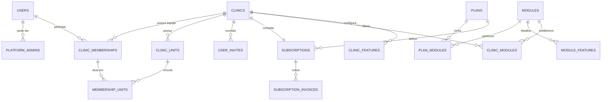
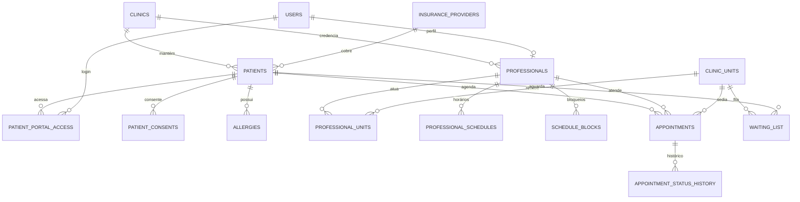
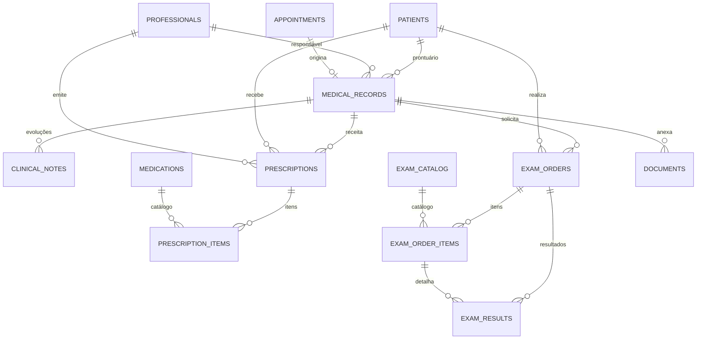
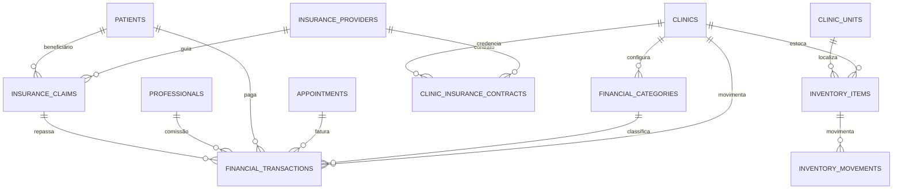

# 02 · Modelo de dados

Fonte de verdade: `db/migrations/*.sql`. Este documento resume entidades, relacionamentos e regras.

## 1. Convenções

- Chaves primárias `uuid` (`gen_random_uuid()`), exceto logs (`bigint identity`).
- Timestamps em `timestamptz`; valores monetários em `numeric(12,2)`; datas em `date`.
- Toda entidade de clínica possui `clinic_id NOT NULL` e FK composta `(id, clinic_id)` nos relacionamentos críticos.
- Exclusão lógica por `status` em pacientes, profissionais, unidades, estoque e documentos. Prontuários e prescrições não são apagados fisicamente.
- CPF/CNPJ armazenados somente com dígitos; validação de formato no banco e dígitos verificadores no backend.
- Campos de auditoria: `created_at`, `updated_at`, `created_by`, `signed_at`, `signed_by`.

## 2. Domínios

| Domínio | Entidades |
|---|---|
| Plataforma | `plans`, `modules`, `module_features`, `plan_modules`, `platform_admins`, `platform_settings`, `gateway_events` |
| Tenant | `clinics`, `clinic_units`, `clinic_memberships`, `membership_units`, `user_invites` |
| Identidade | `users`, `professionals`, `professional_units`, `professional_schedules`, `schedule_blocks` |
| Pacientes | `patients`, `patient_portal_access`, `patient_consents`, `allergies` |
| Agenda | `appointments`, `appointment_status_history`, `waiting_list` |
| Clínico | `medical_records`, `clinical_notes`, `prescriptions`, `prescription_items`, `medications` |
| Exames | `exam_catalog`, `exam_orders`, `exam_order_items`, `exam_results` |
| Financeiro | `financial_categories`, `financial_transactions`, `insurance_claims` |
| Convênios | `insurance_providers`, `clinic_insurance_contracts` |
| Estoque | `inventory_items`, `inventory_movements` |
| Documentos | `documents`, `record_access_logs` |
| Comunicação | `notifications`, `whatsapp_messages`, `ai_interactions` |
| Assinatura | `subscriptions`, `subscription_invoices`, `clinic_modules`, `clinic_features` |
| Auditoria | `audit_logs` |

## 3. Núcleo da plataforma e do tenant

### Regras

- Uma clínica pode ter várias unidades; exatamente uma pode ser matriz (`is_headquarters`).
- Um usuário pode participar de várias clínicas com papéis diferentes, mas só uma membership por clínica.
- O administrador da clínica é uma membership `clinic_admin` ativa.
- O superadministrador é registrado em `platform_admins` — não é membership.
- A assinatura corrente é única por clínica; o histórico financeiro fica em `subscription_invoices`.
- `clinic_modules` registra módulos adicionais/cortesia; o plano define os módulos-base.
- `clinic_features` permite desligar funcionalidades específicas sem alterar o plano.

## 4. Pacientes, agenda e atendimento

### Regras

- `appointments.scheduled_end > scheduled_start`.
- O mesmo profissional não pode ter dois atendimentos sobrepostos, exceto `cancelada`/`faltou` (constraint `EXCLUDE` com `tstzrange`).
- `appointment_status_history` registra cada transição: agendada → confirmada → aguardando → em atendimento → realizada/cancelada/faltou.
- PACIENTE, CPF e telefone são pesquisáveis; CPF é mascarado para quem não tem `pacientes:view_sensitive`.
- Consentimento LGPD é registrado em `patient_consents` com evidência (IP, user agent, versão do termo) e também em campos de resumo no paciente.
- Portal do paciente usa `patient_portal_access`; cada acesso é vinculado a um paciente e a uma clínica, nunca a uma membership.

## 5. Prontuário, prescrições e exames

### Regras de documentação clínica

- Um atendimento gera no máximo um prontuário (`medical_records.appointment_id` é único quando preenchido).
- Retificações criam nova versão (`version`, `parent_id`); a versão anterior permanece auditável.
- Assinatura interna grava `content_hash`, `signature_hash`, `signed_at`, `signed_by`, `signature_method` e `verification_code`.
- `prescriptions` e `documents` também possuem código de verificação público.
- Prescrição só pode ser emitida/assinada pelo profissional vinculado ao usuário (`professional_id = app_professional_id(clinic_id)`).
- Resultados de exames têm status `preliminar`, `liberado`, `retificado` ou `cancelado`; o portal só mostra liberados.
- `medications` e `exam_catalog` aceitam linhas globais (`clinic_id NULL`, geridas pela plataforma) ou customizadas por clínica.

## 6. Financeiro, convênios e estoque

### Regras

- `financial_transactions.type` distingue receita/despesa; `status` distingue pendente/pago/atrasado/cancelado.
- Valores de convênio: `presented_amount` (apresentado), `approved_amount` (aprovado) e glosa calculada pela diferença.
- Guia única por `(clinic_id, provider_id, guide_number)`.
- Estoque mínimo e validade geram alertas; movimentos (`entrada`, `saida`, `ajuste`, `perda`) preservam histórico.
- Categorias financeiras globais são padrão; a clínica pode criar as suas.

## 7. Assinaturas, limites e módulos

- `plans` define preço mensal/anual e limites: usuários, profissionais, unidades, pacientes, armazenamento, interações de IA e mensagens.
- `plan_modules` define os módulos-base do plano.
- `clinic_modules` registra adicionais e cortesias, com preço e vigência.
- `clinic_features` permite desligar uma funcionalidade específica.
- O backend calcula entitlements efetivos:
  `módulos do plano ∪ módulos adicionais ativos − desativados`.
- Limites são verificados no servidor antes de criar usuário, profissional, unidade, paciente ou disparar IA/WhatsApp.
- Excedente de plano pode ser cobrado proporcionalmente na renovação (regra comercial configurável).

## 8. Auditoria e integridade

- `audit_logs` é append-only e encadeado: cada linha contém `prev_hash` e `hash` SHA-256 do conteúdo + timestamp.
- `fn_verify_audit_chain(clinic_id)` recalcula a cadeia e aponta a primeira quebra.
- `record_access_logs` registra leituras de prontuário (quem, quando, IP).
- `gateway_events` garante idempotência de webhooks de pagamento.
- `documents.sha256` e `verification_code` permitem conferir integridade e autenticidade.

## 9. Índices e desempenho

- Índice de `clinic_id` em todas as tabelas de tenant.
- Agenda por `(clinic_id, scheduled_start)`, profissional e paciente.
- Busca textual de pacientes/medicamentos/exames com `pg_trgm` (fallback btree em ambiente sem extensão).
- Financeiro por vencimento e status; notificações por usuário e leitura.
- Paginação obrigatória em listagens; filtros sempre indexados por clínica + período/status.

## 10. Dados de teste

Nenhum dado real é utilizado. Os fixtures de `tools/rls-check.mjs` são sintéticos, vivem em memória e existem apenas para provar o isolamento entre tenants.
